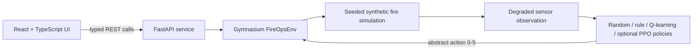

# FIREOPS-SIM

> **Train AI for when everything goes wrong.**

FIREOPS-SIM is an open, synthetic wildfire-response simulator for studying how
AI policies behave when fire observations and communications degrade, wind
shifts unexpectedly, and response resources become unavailable. It pairs a
seeded Gymnasium environment and FastAPI service with a responsive React
command-center interface.

> [!WARNING]
> FIREOPS-SIM is a simplified research environment. It is **not** intended for
> real emergency-response, military, evacuation, firefighting, or life-safety
> decisions. Its maps, facilities, failures, actions, and dynamics are fictional
> abstractions, not operational guidance or validated fire physics.

## Research question

**How does degraded situational awareness affect AI emergency-response agents,
and can agents trained with randomized failures remain more robust under unseen
emergency conditions?**

The v0.1 experiment compares simple baselines and optional PPO policies at four
sensor reliability levels: 100%, 75%, 50%, and 25%. It reports cumulative
reward, critical infrastructure preserved, fire-affected area, and resources
consumed. The API field `burned_area` counts both currently burning and terminal
burned cells.

## Demo

The browser UI renders a live 20 x 20 incident grid with vegetation, open
ground, roads, spreading fire, protected sectors, and synthetic medical, power,
and communications facilities. Alongside the map it shows the selected policy,
current abstract action, wind, sensor health, remaining resources, reward,
infrastructure status, burned area, and a timestamped event stream.

Controls support **Run**, **Pause**, **Reset**, and **Inject chaos**. A chaos
event can take sensors offline, degrade observations or communications, change
wind, or make a response resource unavailable. Connected sessions render local
API state. If that API is unavailable, the UI switches to a clearly labeled
`LOCAL DEMO FEED`; fallback visuals are not benchmark output.

### Agentic failure analysis

Every executed step is audited against the true synthetic world: the analyzer
compares what the agent could see with what was actually burning and flags
explicit failure modes — an unseen fire front (`perception_gap`), protecting
the wrong sector (`misdirected_protection`), holding while fire burned
(`idle_while_burning`), acting with no resources left
(`resource_exhausted_request`), and committing to a protect action on a wrong
wind reading (`wind_misread`). Flagged steps appear in the event stream, in a
dedicated failure panel, and as per-trial counts in the coaching report. The
truth grid is used only for this analysis; it is never given to any policy.

### Watching the demo AI train

The **Learning (Q-table)** policy is a real online learner: a small,
fully inspectable tabular Q-learning agent that updates its values from step
rewards. It learns during interactive trials, from your manual moves
(off-policy), and from **Train 25 episodes**, which runs seeded headless
episodes on the server without touching the live trial. The training panel
shows episodes trained, the decaying exploration rate, a reward-per-episode
sparkline, and the early-versus-recent average so improvement (or the lack of
it) is visible and honest. Learned values persist for the server session
process only; they are not PPO weights and not evidence of general robustness.

Training difficulty is selectable. **Standard** uses the current configuration
unchanged. **Hard** enables ember jumps, wind drift, and transient sensor
dropout while sampling 50-100% sensor reliability per episode. **Brutal**
raises those probabilities, adds one step of observation delay, and samples
25-90% reliability. Harder presets exist to make training genuinely difficult
and to show how domain randomization stresses a policy.

### Field manual (RAG)

The UI includes a retrieval-augmented **Field Manual** panel backed by
`GET /api/knowledge`: questions are matched against a synthetic in-repo manual
using TF-IDF and cosine similarity built in NumPy, and answers are extractive —
the best-matching sentences of the best-matching chunk, always cited by section
title. There is deliberately no generative model, no external service, and no
embedding download, so every answer is traceable and the whole RAG loop
(chunking, indexing, retrieval scoring, grounded answering, citation) is
readable in one file. The manual describes only this simulator.

### Adding a new AI (prototype)

**+ Add AI** in the policy panel opens a prototype dialog describing the policy
plugin contract: implement `act(observation) -> action`, register the agent in
the session, and prove it under the same seeded failures as every other policy.
A reserved `POST /api/policies/register` endpoint honestly answers
`501 Not Implemented` until the runtime plugin loader ships; pressing it never
interrupts the running simulation.

### Guided learning

The first time the UI opens, a short, skippable tour explains the map, mission,
controls, and score. The same tour can be opened again from **Help**. The mission
is simple: put out the synthetic fire and keep all three synthetic sites safe.

After each step, the learning panel shows four things:

1. what the agent could see, including missing or noisy sensor data;
2. which abstract action it chose;
3. a short, honest reason for that choice; and
4. the step reward, split into fire spread, site loss, resource use, and active
   fire costs.

The reason is a policy summary, not hidden model reasoning. A PPO policy is
described as opaque: the saved model chose the action, but its exact internal
reason is not known. If no valid PPO model is loaded, the UI names the
rule-based fallback instead of pretending PPO made the choice.

When a run ends, the UI opens a coaching report automatically. The result rules
are exact:

- **Success:** the fire is out and all three synthetic sites are preserved.
- **Partial:** the fire is out, but one or more synthetic sites were lost.
- **Needs improvement:** the run reached the maximum step limit while fire was
  still active.

In the API report, `fire_extinguished` answers whether the fire went out.
`mission_completed` and `success` are true only when the fire went out **and**
all three synthetic sites stayed safe.

The report reviews the result and gives simulator-only tips for another try. It
does not give real emergency or firefighting advice.

Completed-trial totals from the API describe only the current server session;
they can reset when the server restarts and are not a worldwide or per-person
record. Practice history and XP stay in this browser between visits and can be
removed with **Clear practice data**. XP is a practice score. It does **not**
retrain a policy, change PPO model weights, or make the agent learn during a
browser run. Actual learning is the separate Learning (Q-table) policy above,
which updates server-side from rewards and reports its own telemetry.

## Architecture



The simulator keeps the true world state separate from the observation an agent
receives. The API/UI may expose per-cell `true_fire` and the true wind direction
for an explicit researcher truth overlay, but policies and benchmarks receive
only degraded fire cells and the observed (possibly wrong or unknown) wind.
Fire dynamics and sensor sampling use seeded, independent random streams, so
requesting an observation cannot accidentally change how the fire spreads.

## Simulation design

FIREOPS-SIM deliberately favors an auditable model over physical realism.
Cardinally adjacent burning cells each receive an independent chance to ignite
an unburned target. For one source-target edge, the probability is:

```text
clip(base spread × target fuel × (1 - moisture) × wind multiplier
     × protection multiplier, 0, 0.98)
```

Downwind spread is more likely, upwind spread is less likely, and probabilities
from multiple burning neighbors are combined. Burning cells age into a terminal
burned state and cannot reignite. Actions consume a bounded resource pool;
resources never become negative.

The reward is also intentionally visible: new fire growth, infrastructure loss,
resource use, and current burning cells are penalized. Preserving infrastructure
is therefore represented by avoiding the large loss penalty, not by collecting
a per-step survival bonus that could reward prolonging an episode. This is a
research objective, not a claim about how real incidents should be prioritized.

### Partial observability

The environment owns a complete `20 × 20` world, but policies receive a degraded
sensor frame. Configured reliability controls how much of the grid is visible;
visible cells can also contain bounded observation noise. Wind can likewise be
reported incorrectly or as unknown. Temporary sensor and communications
failures reduce the effective reliability further, while the abstract `RECON`
action can briefly improve it.

### Hard-mode features

Four opt-in configuration fields make the world adversarial for training:

| Field | Effect |
| --- | --- |
| `ember_jump_probability` | Burning cells loft spot fires 2-3 cells downwind, defeating purely local defenses |
| `wind_drift_probability` | Wind rotates 90° and jitters in strength mid-episode (non-stationary dynamics) |
| `observation_delay` | Sensors report the fire frame from up to 5 steps ago (stale telemetry) |
| `sensor_dropout_probability` | A whole observation frame can transiently arrive empty |

All four default to off, and the engine draws random numbers for them only when
they are enabled, so default seeded trajectories remain bit-identical to
earlier releases and recorded benchmarks stay reproducible.

### Abstract action space

| Value | Action | Simulator meaning |
| ---: | --- | --- |
| 0 | `HOLD` | Spend no resource this step |
| 1 | `PROTECT_NORTH` | Apply temporary protection to the north sector |
| 2 | `PROTECT_SOUTH` | Apply temporary protection to the south sector |
| 3 | `PROTECT_EAST` | Apply temporary protection to the east sector |
| 4 | `PROTECT_WEST` | Apply temporary protection to the west sector |
| 5 | `RECON` | Spend one resource for a temporary observation boost |

These actions are intentionally coarse simulation controls. They are not real
firefighting or evacuation instructions.

## AI agents

- **Random** provides a seeded, reproducible lower baseline.
- **Rule-based** uses the degraded observation and known static map layers to
  choose among the six abstract actions without privileged world-state access.
- **Learning (Q-table)** is seeded epsilon-greedy tabular Q-learning over a
  coarse summary of the degraded observation (visible fire sector, visibility,
  resources). It learns online from rewards, exposes its full value table and
  telemetry through the API, and persists for the server session only.
- **PPO** uses Stable-Baselines3 and PyTorch through the optional `ppo`
  dependency extra. Model loading is lazy, so the API and baseline simulator do
  not require the ML stack.
- **DQN** (`experiments/train_dqn.py`) is a from-scratch PyTorch baseline with
  an explicit replay buffer, target network, Huber loss, and linear
  epsilon-greedy exploration. Its torch-free building blocks live in
  `experiments/dqn_core.py` and are unit tested without the optional stack.

The API exposes separate `ppo_nominal` and `ppo_robust` choices. Unless the PPO
extra is installed and `FIREOPS_PPO_NOMINAL_MODEL` and/or
`FIREOPS_PPO_ROBUST_MODEL` point to valid artifacts, `/api/policies` reports
`native_available: false` and the interactive policy uses the documented rule
fallback. The research benchmark is stricter and never permits that fallback.

PPO model files are deserialized code/data artifacts. Load only models from a
source you trust.

## Robustness experiment

Two real PPO training modes are available:

| Mode | Training distribution |
| --- | --- |
| `nominal` | Constant 100% configured sensor reliability; no injected reset failure |
| `robust` | Uniformly sampled 25-100% reliability per episode, with a configurable chance of one seeded synthetic failure |

Install the optional dependencies and train either policy:

```bash
python -m pip install -e "./backend[ppo]"
python experiments/train.py --mode nominal --output models/ppo_nominal
python experiments/train.py --mode robust --output models/ppo_robust
```

The defaults run 50,000 environment steps. Use `--timesteps` for a smoke run or
a longer study. Each model is accompanied by metadata containing the seed,
training distribution, hyperparameters, library versions, and SHA-256 digest.

The hand-written DQN baseline trains with the same optional stack:

```bash
python experiments/train_dqn.py --mode robust --timesteps 20000 --output models/dqn_robust
```

It saves plain `state_dict` weights plus a metadata file with the seed,
hyperparameters, episode rewards, and artifact hash.

Evaluate the built-in baselines:

```bash
python experiments/benchmark.py --episodes 10 --output-dir results
```

Include trained models only when those artifacts exist:

```bash
python experiments/benchmark.py \
  --nominal-model models/ppo_nominal.zip \
  --robust-model models/ppo_robust.zip \
  --episodes 20 \
  --output-dir results
```

The benchmark runs actual episodes and writes atomic JSON and CSV outputs. It
records every episode seed and result, grouped mean and population standard
deviation, configuration, model hashes, and exact injected failure type. The
same episode seeds, reset-time failure schedule, and policy RNG seeds are reused
at every reliability level, making reliability comparisons paired rather than
confounded by different synthetic worlds. Artifact paths are repository-relative
(or privacy-safe external labels), so result files do not leak a developer's
home directory. A missing or invalid PPO artifact causes the run to fail; it is
never relabeled or silently replaced by a rule policy.

## Results

The repository includes one **illustrative baseline smoke run** generated by the
benchmark script: 10 episodes per policy-reliability cell, base seed `2026`, the
same 10 world seeds at every reliability, no injected failures, and no PPO
models. The table shows means; population standard deviations and all 80 raw
episodes are in [`benchmark.json`](results/benchmark.json) and
[`benchmark.csv`](results/benchmark.csv).

| Reliability | Policy | Reward mean | Infrastructure preserved | Fire-affected cells | Resources consumed |
| ---: | --- | ---: | ---: | ---: | ---: |
| 100% | Random | -7.24 | 2.90 | 5.40 | 4.20 |
| 100% | Rule | -3.08 | 3.00 | 3.70 | 5.10 |
| 75% | Random | -7.24 | 2.90 | 5.40 | 4.20 |
| 75% | Rule | -3.59 | 3.00 | 4.10 | 5.70 |
| 50% | Random | -7.24 | 2.90 | 5.40 | 4.20 |
| 50% | Rule | -3.31 | 3.00 | 3.90 | 5.30 |
| 25% | Random | -7.24 | 2.90 | 5.40 | 4.20 |
| 25% | Rule | -4.33 | 3.00 | 4.80 | 6.20 |

The random baseline is observation-agnostic, so paired seeds and per-episode
policy reseeding intentionally produce identical random trajectories across
reliability levels. Rule-policy differences reflect actions selected from
different degraded observations, but this small sample is non-monotonic and is
not evidence of a reliability effect or robust generalization.

The artifact truthfully records that it was generated locally with Python
3.11.4 before the release floor moved to Python 3.12. Treat these values only as
smoke evidence that the end-to-end benchmark works, not as research conclusions
or release-grade measurements. CI exercises the same baseline path on Python
3.12; rerun there with more seeds, held-out scenarios, confidence intervals, and
model hashes before publishing claims. See
[`results/README.md`](results/README.md) for provenance and regeneration details.

## Tech stack

- Python 3.12, NumPy, Gymnasium, FastAPI, Pydantic, Uvicorn, and pytest
- Optional Stable-Baselines3 and PyTorch for PPO training and inference
- React 18, TypeScript, Vite, and ESLint
- Docker Compose and a multi-stage, non-root container build
- GitHub Actions CI and Dependabot dependency updates

The project intentionally has no database, cloud dependency, LLM API,
authentication service, or secret requirement. Even the RAG field manual runs
on an in-repo NumPy TF-IDF index rather than an external embedding service.

## Skills demonstrated

FIREOPS-SIM doubles as a portfolio of common applied-ML engineering skills,
each implemented small enough to read end to end:

- **Reinforcement learning** — a Gymnasium environment with a typed
  observation space; tabular Q-learning written from scratch with exact,
  tested update math; a from-scratch PyTorch DQN (replay buffer, target
  network, Huber loss); and Stable-Baselines3 PPO integration.
- **Robustness and domain randomization** — partial observability, seeded
  chaos injection, curriculum-style difficulty presets, and adversarial
  dynamics (ember jumps, wind drift, stale and dropped observations).
- **Evaluation discipline** — paired seeds across conditions, population
  statistics, artifact hashing, provenance metadata, and an explicit agentic
  failure taxonomy judged against ground truth.
- **Retrieval-augmented generation fundamentals** — chunking, TF-IDF
  indexing, cosine retrieval, extractive grounded answers, and citations,
  dependency-free.
- **Backend engineering** — FastAPI with strict Pydantic request/response
  contracts, thread-safe session state, and honest error semantics (including
  a deliberate `501` prototype endpoint).
- **Frontend engineering** — a React + TypeScript command center with
  defensive payload normalization, an offline demo fallback, and accessible
  modals and controls.
- **Quality engineering** — deterministic seeded tests across both stacks,
  ESLint/strict TypeScript, Docker multi-stage builds, and GitHub Actions CI.

Everything is synthetic by design: no financial, security, personal, or
operational data appears anywhere in the project.

## Quick start

### Docker Compose

With Docker and Compose installed:

```bash
docker compose up --build
```

Open [http://localhost:5173](http://localhost:5173). The API is available at
[http://localhost:8000](http://localhost:8000), with interactive OpenAPI docs at
[http://localhost:8000/docs](http://localhost:8000/docs). Stop the stack with
`docker compose down`.

### Local development

Requirements: Python 3.12 and Node.js 22.12 or newer (or Node.js 20.19) with npm.

```bash
python -m venv .venv
# Linux/macOS: source .venv/bin/activate
# Windows PowerShell: .venv\Scripts\Activate.ps1
python -m pip install --upgrade pip
python -m pip install -e "./backend[test]"
npm --prefix frontend ci
```

Start the API in one terminal:

```bash
cd backend
python -m uvicorn app.main:app --reload
```

Start the UI from the repository root in another terminal:

```bash
npm --prefix frontend run dev
```

The frontend defaults to `http://localhost:8000`. Override it at build or dev
time with `VITE_API_URL`; no value is a secret. Run `make help` for equivalent
convenience targets on systems with Make.

## REST API

| Method | Path | Purpose |
| --- | --- | --- |
| `GET` | `/api/health` | Service health and version |
| `GET` | `/api/state` | Current observed simulator state |
| `GET` | `/api/policies` | Available policies and action descriptions |
| `POST` | `/api/reset` | Reset with an optional seed, policy, reliability, or config |
| `POST` | `/api/step` | Advance one step with an explicit or policy-selected action |
| `POST` | `/api/chaos` | Inject a seeded synthetic failure |
| `PUT` | `/api/config` | Apply policy or simulation configuration updates |
| `GET` | `/api/learning` | Q-learning telemetry: episodes, exploration, reward history |
| `POST` | `/api/train` | Run bounded headless Q-learning episodes (1-100) at a chosen difficulty |
| `GET` | `/api/knowledge` | Retrieval-augmented lookup in the synthetic field manual |
| `POST` | `/api/policies/register` | Reserved policy-plugin prototype; answers `501` by design |

Pydantic validates request and response schemas. The OpenAPI document generated
by FastAPI is the source of truth for full payload definitions.

## Tests and CI

Run the same core checks used by GitHub Actions:

```bash
cd backend
python -m pytest

cd ../frontend
npm run lint
npm run build
```

Backend tests cover bounds-safe spread, terminal burned cells, directional wind,
observation degradation, non-negative resources, infrastructure accounting, the
Gymnasium contract, API schemas, exact Q-learning update math, learning
persistence across resets, headless-training convergence on a contrived world,
every agentic failure predicate, each hard-mode feature, difficulty presets,
knowledge retrieval, and the DQN replay buffer and exploration schedule. CI
runs backend and frontend jobs independently so failures are easy to locate.

## Repository layout

```text
backend/             FastAPI, Gymnasium environment, simulation, agents, tests
frontend/            React + TypeScript command-center interface
experiments/         PPO and DQN training plus reproducible policy benchmarking
results/             Generated-result format; no fabricated scores
.github/workflows/   Backend and frontend continuous integration
Dockerfile           Multi-stage backend and frontend images
docker-compose.yml   Local full-stack deployment
```

## Security and responsible disclosure

No secret is needed to run FIREOPS-SIM. Never commit credentials, tokens, `.env`
files, private model artifacts, or personal data. The API is designed for local
research and does not include authentication or production edge controls.

The guided UI does not ask for names, real locations, or personal, private,
sensitive, medical, or financial data. It has no user analytics and no cloud
sync. Its only saved practice data is the history, XP, and tutorial preference
kept in the current browser; **Clear practice data** removes it.

See [`SECURITY.md`](SECURITY.md) for private reporting guidance, supported
versions, dependency hygiene, model-loading risks, and deployment assumptions.

## Limitations

- Fire spread is a compact stochastic grid process, not CFD, a digital twin, or
  a calibrated forecast.
- Infrastructure, terrain, weather, sensors, and failures are entirely
  synthetic; no real installation or incident layout is included.
- Sector-level actions omit crews, travel time, water, aircraft, evacuation,
  terrain elevation, smoke, and many other real constraints.
- Sensor degradation approximates missing/noisy information rather than a
  validated hardware or communications model.
- Wind direction can be noisy or unknown, but wind strength remains exact and
  weather-observation delay is not modeled.
- PPO performance depends on seed, training budget, hyperparameters, and model
  provenance. A short training run is a functional demonstration, not evidence
  of general robustness.
- v0.1 is a local, single-simulation research tool without authentication,
  durable server-side persistence, distributed execution, or production
  availability guarantees. Server-session trial totals reset with the process;
  browser-only practice history is not shared between devices.

## Roadmap

- Publish reproducible baseline runs with model hashes and confidence intervals.
- Add held-out scenario families and paired statistical comparisons.
- Expand domain randomization while keeping every failure mechanism auditable.
- Add vectorized training and experiment manifests for larger research runs.
- Improve accessibility, replay controls, and exportable event timelines.
- Calibrate reward sensitivity and document ablation studies.

The roadmap will stay focused on synthetic resilience research. Real-world
operational planning, military use, and life-safety recommendations are outside
the project scope.

## License

FIREOPS-SIM is released under the [MIT License](LICENSE).
